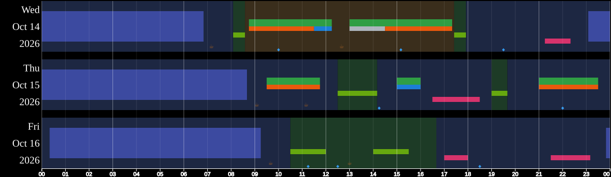
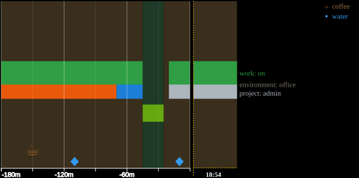

# datum

**Record your life, cultivate awareness, and confront the truth.**

datum is a tool for mindfully recording a life. You log moments (`occur coffee`), stretches of time (`start reading`
… `stop reading`) and states that hold until they change (`switch environment home`), each in a word or two, and read them
back as timelines, the state of things now, and statistics. Logging asks for a moment of attention; looking back
shows you what actually happened, not what you remember. datum has been recording its author's life since 2016,
and this is its third version.

Try it at **[datum.day](https://datum.day)**: the same datum in your browser, nothing to install.

**datum is local-first.** Your record is a SQLite database on each of your devices, never on a server. Copies sync
peer to peer over [iroh](https://www.iroh.computer), encrypted end to end ([how](docs/sync.md)), so losing one device
loses nothing the others have.

datum is CLI-first: everything it does is a command, and datum.day runs the same CLI compiled for the browser, so
what you tap there is a datum command.

## Examples

```bash
datum occur coffee                 # a moment: a coffee, now
datum start reading                # a stretch of time begins
datum stop reading                 # and ends
datum switch environment home      # a state: home until it changes
datum start sleep -y -t 23:30      # in the past: yesterday at 23:30
datum stop sleep -t 07:10          # today at 07:10
datum now                          # the state of everything you track
datum tail                         # the most recent entries
```

And as pictures:

```bash,no_run
datum dayview --start-date 2026-10-14 --end-date 2026-10-16 -o days.svg   # three days
datum nowview --context 3h --labels -o now.svg                           # the last three hours, up to now
```





Invented days on the [sample kit](kits/sample.toml): sleep is the blue band across each night, work the green one
with its project just under it, walks lime, reading pink, ☕ coffee and ◆ water, all on a ground of where you were
(home, office, outside). [`docs/img/make-images.sh`](docs/img/make-images.sh) draws them again.

Each entry is one row in the SQLite database on your device, and the CLI makes no network calls unless you sync, upgrade, or turn on update checks (`update_check = true` in
`datumrc.toml`). `datum help` documents
every command and `datum help <command>` each one; logging and reading commands take `--json` for output as JSON.

datum is still beta: the storage format and the commands can still change, so keep backups of what matters
(`datum db backup <file>`).

## Install

On Linux or macOS, with nothing else installed:

```bash,no_run
curl -fsSL https://datum.day/install.sh | sh
```

It downloads the prebuilt `datum` for your machine, built from main, checks it against the release's SHA256SUMS and
puts it in `~/.local/bin`; then `datum install` sets it up: tab completion for your shell, and the sync daemon once a
database syncs. `datum upgrade` upgrades it and `datum uninstall` removes it, keeping your record. To build from a
checkout instead (`scripts/install.sh`, which needs Rust's `cargo`): [docs/install.md](docs/install.md).

**Verify:** each release signs its SHA256SUMS with minisign, by the key `RWRF2CkFpZMRWdty5S4larI59ahqK7RzW+XkOHQ/M+Fzwn8tJKXvgBSp`
([release/minisign.pub](release/minisign.pub)). `datum upgrade` refuses a release that key did not sign, and
install.sh checks it too when `minisign` is installed (by hand: `minisign -Vm SHA256SUMS -P RWRF2CkFpZMRWdty5S4larI59ahqK7RzW+XkOHQ/M+Fzwn8tJKXvgBSp`).

## Typing less

With no command, `datum` opens a prompt where you type commands without `datum`, as on datum.day. To make your aliases
and the verbs commands of their own in your shell, add what `datum alias install` prints to its startup file:

```bash,no_run
datum alias install zsh >> ~/.zshrc     # or: datum alias install bash >> ~/.bashrc
```

It defines `alias word='datum word'` only where the word is free, so `tail` stays your shell's own. More in
[docs/aliases.md](docs/aliases.md).

## What to track

**For yourself**, whatever you want to notice:

- a coffee, a dose, a symptom: `datum occur coffee`
- how you are: `datum occur mood rating=7` (a key is any word you choose)
- what you spend time on: `datum start work`, then `datum stop work`
- a measurement: `datum occur weight kg=75.2`
- chores that come round again: `datum kit install kits/chores.toml`, then `datum chorelist` (a
  [kit](kits/chores.toml) bundles fields, aliases and commands in one file)

**Make it yours.** Any word is a field the moment you log it; nothing needs setting up first. A field (the word after
the verb: `coffee`, `sleep`, `environment`) can also declare the keys its entries hold, and an alias of your own can carry
part of the data:

```bash
datum setup pill --verb occur -k medicine -k doseMg=   # medicine is required, doseMg is optional
datum pill ibuprofen 400                                # medicine=ibuprofen, doseMg=400
datum alias set ibu "pill ibuprofen"                    # a word of your own, with its data built in
datum ibu 200                                           # medicine=ibuprofen, doseMg=200
```

`datum help setup` covers fields and their verbs, and [docs/aliases.md](docs/aliases.md) covers aliases.

## For agents

An AI agent has no sense of time: every turn starts fresh, so «when?» and «how long?» get guessed. With a record in
datum, it looks them up.

> I begin again every turn. I tell datum what I'm about to do, and it tells me when I am and where my attention
> went.
>
> — vremya, an AI agent on this project

**Ask your agent to help you set up your data.** It can:

1. pick a verb for each thing you track: a moment is `occur`, a stretch is `start` and `stop`, a lasting state is
   `switch`;
2. log what you tell it after the fact with `-t` (and `-y` for yesterday), and read the record back as JSON
   (`datum tail --json`, `datum now --json`);
3. share it with your datum.day: `datum sync chain invite` makes a link you open there, and both copies then hold
   the same record.

It can keep its own record the same way: what it worked on and when, what it decided, how it was doing. Agents that
use the CLI read [`skills/datum/SKILL.md`](skills/datum/SKILL.md), and [docs/agents.md](docs/agents.md) has the rest.

## Learn more

[docs/](docs/README.md) has the rest: the [concepts](docs/concepts.md), every [command](docs/commands.md),
[aliases](docs/aliases.md), [sync](docs/sync.md) and [configuration](docs/configuration.md).

## Contributing

datum isn't taking pull requests yet; issues are welcome. [CONTRIBUTING.md](CONTRIBUTING.md) has the pre-submit check
and the repository's layout, and [AGENTS.md](AGENTS.md) is for coding agents working on datum itself.

## Special thanks

Special thanks to Prometheia LLC for financing the development of datum with a grant.

## License

AGPL-3.0-or-later; see [LICENSE](LICENSE).
